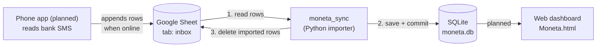

# Moneta Sync

Moneta is a private, single-user personal finance tracker built from three parts:

1. **Phone app** (planned) reads your bank SMS messages and saves them on the phone.
2. **Google Sheet** (used as a free bridge) receives those messages whenever the phone has internet.
3. **Web dashboard** (planned connection) shows your data from a local database.

This repository currently contains **the piece in the middle**: `moneta_sync`, a Python program that pulls new rows out of the Google Sheet, saves them into a local SQLite database, and then removes them from the sheet.

> **Status**
> | Part | State |
> |---|---|
> | Sheet → SQLite importer (`moneta_sync`) | Built and unit-tested against a fake sheet. Not yet run against a real Google Sheet. |
> | Web dashboard (`Moneta.html`) | A working UI that currently shows generated sample data. It is not yet connected to the database. |
> | Phone app | Not built yet. |

---

## Table of contents

1. [Why this design](#why-this-design)
2. [Big picture](#big-picture)
3. [What happens in one importer run](#what-happens-in-one-importer-run)
4. [The sheet contract](#the-sheet-contract-what-the-phone-must-write)
5. [The database](#the-database)
6. [Safety guarantees and failure scenarios](#safety-guarantees-and-failure-scenarios)
7. [Project layout and how the code works](#project-layout-and-how-the-code-works)
8. [Setup](#setup)
9. [Running it](#running-it)
10. [Looking at your data](#looking-at-your-data)
11. [Tests](#tests)
12. [Security and privacy](#security-and-privacy)
13. [Backups](#backups)
14. [Troubleshooting](#troubleshooting)
15. [Known limitations](#known-limitations)
16. [Roadmap](#roadmap)

---

## Why this design

- **The phone is often offline.** It must be able to collect SMS at any time and deliver them later. So the phone keeps its own queue and only needs a simple "append a row" operation when internet is available.
- **Google Sheets is free and has a ready-made API.** It works as a mailbox between the phone and your computer, so you do not need to run and pay for a server.
- **The sheet is a temporary inbox, not the database.** Your real, permanent data lives in a local SQLite file on your own machine. Once a row is safely saved there, it is deleted from the sheet.

## Big picture



Data only ever moves one way: phone → sheet → database → dashboard. After step 3, the database holds the only copy of that transaction (see [Backups](#backups)).

## What happens in one importer run

Each run does the following, in this exact order:

1. **Connect and read.** Read every row of the `inbox` tab. Row 1 is the header. Columns are matched by header name, so their order does not matter. Numbers and dates are read unformatted, so a 13-digit timestamp is not turned into `1.76E+12`.
2. **Validate each row.** Required fields must be present, `type` must be `income` or `expense`, `amount` must be a whole number above zero, and `date` must be understandable. Rows that fail are skipped, counted as `invalid`, and logged with a reason. They stay in the sheet.
3. **Save to the database in one transaction.** Every valid row is inserted with `INSERT OR IGNORE`. A row whose `uid` is already in the database is silently ignored (that is how duplicates are prevented). If anything goes wrong, the whole transaction rolls back and nothing is saved.
4. **Commit.** The data is now durable on disk.
5. **Delete from the sheet.** Only now does the importer remove rows from the sheet. It re-reads the sheet right at this moment and finds the rows to delete by their `uid` (never by an old row number), then deletes them bottom-up in a single request. This covers both the newly saved rows and the duplicates.
6. **Log the run** in the `sync_runs` table: how many rows were read, inserted, duplicates, invalid, deleted, and any error.

The key rule: **a row is deleted from the sheet only after it has been committed to the database.**

## The sheet contract (what the phone must write)

The importer reads the first tab named `inbox` (change with `--worksheet`). Row 1 must be a header. Column order is free, but these names are required (lower-case is safest; matching ignores case and surrounding spaces):

| Column | Required | Meaning |
|---|---|---|
| `uid` | yes | A unique id created by the phone for each SMS, for example a hash of sender + timestamp + message text. **This is what prevents duplicates**, so the same SMS must always get the same uid. |
| `date` | yes | When the transaction happened. Accepted: an ISO-8601 string with timezone (`2026-10-20T14:30:00+03:30`), epoch milliseconds, or epoch seconds. A string with no timezone is treated as the local time of the machine running the importer. |
| `type` | yes | `income` or `expense` (any capitalisation). |
| `amount` | yes | A whole number greater than zero, always positive. The sign comes from `type`. Commas and Persian/Arabic digits are accepted. |
| `description` | yes | Merchant or short description. |
| `balance` | no | The bank balance after the transaction, if the SMS reported it. Leave empty otherwise. |
| `ref` | no | A reference or tracking number from the SMS. |
| `raw` | no | The original SMS text. Stored in the database but never meant to be displayed. |

**Amount unit:** the dashboard works in **toman** (1 toman = 10 rial). The importer stores `amount` and `balance` exactly as written and does no conversion, so the phone app should convert from rial to toman before writing, if the bank SMS uses rial.

**Write values as RAW.** When the phone app writes to the sheet, it should use the "RAW" value input mode, not "user entered". Otherwise Google may try to be clever and reformat IDs and timestamps.

Example (a test row you can paste under the header):

```
uid    date                       type     amount   description  balance  ref  raw
test1  2026-10-26T10:00:00+03:30  expense  250000   Snapp        1750000  R1
```

## The database

SQLite file, default `moneta.db`, created automatically on the first run. It uses WAL mode, so you may also see `moneta.db-wal` and `moneta.db-shm` files next to it. That is normal.

### Table `transactions`

| Column | Type | Meaning |
|---|---|---|
| `id` | integer, primary key | Internal row id. |
| `uid` | text, **unique**, not null | The phone's id. The unique constraint is the duplicate guard. |
| `date` | integer, not null | Epoch milliseconds. |
| `type` | text, not null | `income` or `expense` (enforced by a CHECK constraint). |
| `amount` | integer, not null | Always greater than zero (enforced). |
| `description` | text, not null | Merchant or description. (Named `description`, not `desc`, because `desc` is a reserved word in SQL.) |
| `cat` | text, nullable | Category id. Empty after import; the dashboard will set it. |
| `note` | text, not null | Free note. Empty after import. |
| `ref` | text, nullable | Reference number. |
| `bal` | integer, nullable | Bank balance after this transaction, if known. |
| `src` | text, not null | Where it came from. Imported rows are `sms`. |
| `st` | text, not null | `review` (needs your confirmation) or `ok`. Imported rows start as `review`. |
| `raw` | text, nullable | Original SMS text. |
| `created` | integer, not null | Epoch ms when the row was imported. |

These names deliberately match the fields used in `Moneta.html` (`type`, `amount`, `cat`, `note`, `ref`, `bal`, `src`, `st`, `created`), so connecting the dashboard later needs little translation.

### Table `sync_runs`

One row per importer run, successful or not. The dashboard's "Sync" card can use it for "last successful sync" and "failed / pending".

| Column | Meaning |
|---|---|
| `ran_at` | Epoch ms of the run. |
| `rows_read` | Data rows found in the sheet. |
| `inserted` | New transactions saved. |
| `duplicates` | Valid rows whose uid was already saved. |
| `invalid` | Rows skipped because they failed validation. |
| `deleted` | Rows removed from the sheet. |
| `error` | Error text, or empty if the run was clean. |

## Safety guarantees and failure scenarios

| Situation | What happens |
|---|---|
| Internet is down or Google returns an error while reading | The run records an error and changes nothing. The next run tries again. |
| The program crashes or loses connection **after saving but before deleting** | The rows stay in the sheet and are also in the database. Next run: they are counted as duplicates, skipped, and then deleted. Nothing is lost or doubled. |
| The delete request fails (for example quota exceeded) | Same as above. Data is safe in the database; the delete is retried next run. |
| The phone sends the same SMS twice (same `uid`) | One database row. Both sheet rows are deleted. |
| The same `uid` appears twice inside one run | One database row; both sheet rows are deleted. |
| The phone adds a new row while a run is in progress | The new row is not touched by this run (it was not read) and is imported on the next run. |
| A row has a bad value (for example `amount` = `abc`) | It stays in the sheet, a warning with the row number and reason is logged, and it counts as `invalid`. Fix it in the sheet and the next run imports it. |
| The header is missing a required column, or the tab is empty | The run fails with a clear message, and **nothing is deleted**. |
| The database transaction fails halfway | It rolls back completely. Nothing is saved and nothing is deleted. |

## Project layout and how the code works

```
moneta-sync/
├── moneta_sync/
│   ├── __init__.py
│   ├── __main__.py      command-line entry point and the optional loop
│   ├── db.py            database connection and schema
│   ├── importer.py      validation and the import logic (no Google code here)
│   └── sheets.py        Google Sheets access through gspread
├── tests/
│   └── test_importer.py unit tests using a fake in-memory sheet
├── requirements.txt     only dependency: gspread
└── README.md
```

**`importer.py`** is the heart of the project and knows nothing about Google. It defines a tiny `Sheet` interface with two methods, `read_rows()` and `delete_rows_by_uid(uids)`. It contains:

- `parse_row(...)`: turns one raw sheet row into a validated `Transaction`, or raises `ValueError` with a human-readable reason.
- `parse_date_ms(...)` and `parse_int(...)`: tolerant parsers for dates and whole numbers.
- `import_once(sheet, conn)`: runs the sequence described in [What happens in one importer run](#what-happens-in-one-importer-run) and returns a `RunResult`. It never raises for a failed run; it records the error instead, so a long-running loop is not killed by one bad moment.

**`sheets.py`** is the real Google implementation of the `Sheet` interface:

- Connects with a service account and opens the sheet by ID and tab name.
- `read_rows()` reads the grid, maps cells to header names, and skips fully empty rows.
- `delete_rows_by_uid()` re-reads the sheet, finds the current row numbers of the matching uids, merges neighbouring rows into ranges, and sends **one** `batchUpdate` request that deletes those ranges from the bottom up, so earlier deletions never shift later ones. Row 1 (the header) is never touched.

**`db.py`** opens SQLite (WAL mode) and creates the tables if they do not exist.

**`__main__.py`** parses options, connects, runs `import_once`, logs a one-line summary, and either exits or sleeps and repeats.

Because the importer talks to the sheet only through the small interface, the tests use a fake sheet and need neither internet nor Google credentials.

## Setup

You need Python 3.9 or newer.

### 1. Google access (one time)

1. **Create a project** at <https://console.cloud.google.com> (project picker → New Project).
2. **Enable the Google Sheets API** (menu → APIs & Services → Library → "Google Sheets API" → Enable).
3. **Create a service account** (APIs & Services → Credentials → Create credentials → Service account). Skip the optional role steps.
4. **Create a JSON key** for it (the service account → Keys → Add key → Create new key → JSON). Save the file as `service_account.json` in the project folder.
5. **Create the spreadsheet.** Rename the first tab to `inbox` and type the header in row 1: `uid`, `date`, `type`, `amount`, `description`, `balance`, `ref`, `raw`.
6. **Share the spreadsheet** with the service account's e-mail address (it looks like `name@project.iam.gserviceaccount.com`, also visible as `client_email` inside the JSON file), with the **Editor** role. Editor is required because the importer deletes rows.
7. **Copy the sheet ID** from its URL: the long text between `/d/` and `/edit`.

### 2. Python environment

```bash
python -m venv .venv
# Windows:   .venv\Scripts\activate
# macOS/Linux: source .venv/bin/activate
pip install -r requirements.txt
```

## Running it

Run once:

```bash
python -m moneta_sync --sheet-id YOUR_SHEET_ID
```

Run continuously, checking every 60 seconds:

```bash
python -m moneta_sync --sheet-id YOUR_SHEET_ID --interval 60
```

Options (each can also be set with an environment variable):

| Option | Environment variable | Default | Meaning |
|---|---|---|---|
| `--sheet-id` | `MONETA_SHEET_ID` | none (required) | Google Sheet ID |
| `--worksheet` | `MONETA_WORKSHEET` | `inbox` | Tab name |
| `--credentials` | `MONETA_CREDENTIALS` | `service_account.json` | Path to the service account key |
| `--db` | `MONETA_DB` | `moneta.db` | Path to the SQLite file |
| `--interval` | none | `0` | Seconds between runs. `0` means run once and exit. |

Each run prints one line, for example:

```
2026-10-26 10:05:01 INFO read=3 inserted=2 duplicates=1 invalid=0 deleted=3
```

In run-once mode the exit code is `1` if the run had an error and `0` otherwise, so you can use it in scripts or schedulers. In loop mode, errors are logged and the next run happens as normal.

Keep `--interval` reasonable (30 to 60 seconds is plenty). Google limits the number of requests per minute, and every run with data makes two reads and one write.

## Looking at your data

You can open `moneta.db` with the free [DB Browser for SQLite](https://sqlitebrowser.org), or with the `sqlite3` command-line tool:

```bash
# last 10 transactions
sqlite3 moneta.db "SELECT datetime(date/1000,'unixepoch','localtime'), type, amount, description, st FROM transactions ORDER BY date DESC LIMIT 10;"

# how many rows still need review
sqlite3 moneta.db "SELECT COUNT(*) FROM transactions WHERE st='review';"

# the last 5 importer runs
sqlite3 moneta.db "SELECT datetime(ran_at/1000,'unixepoch','localtime'), rows_read, inserted, duplicates, invalid, deleted, error FROM sync_runs ORDER BY id DESC LIMIT 5;"
```

If you use a graphical tool, avoid leaving a write transaction open while the importer runs, or the importer may report "database is locked".

## Tests

```bash
python -m unittest discover -s tests -v
```

The 8 tests use a fake in-memory sheet and an in-memory SQLite database. They check:

- a normal import saves rows and empties the sheet;
- re-running never creates duplicates;
- the same uid twice in one batch gives one row;
- invalid rows stay in the sheet while valid ones import;
- a failed delete loses nothing and recovers on the next run;
- a row added by the phone mid-run is not deleted;
- a failed read is reported, not raised, and is logged in `sync_runs`;
- dates (ISO, seconds, milliseconds, UTC and offset forms) and numbers (commas, Persian digits) parse correctly.

**Not covered by tests:** the real Google calls in `sheets.py`. Do a first run with a test row (see [The sheet contract](#the-sheet-contract-what-the-phone-must-write)) to confirm your credentials and sharing are correct.

## Security and privacy

- **`service_account.json` is a password.** Anyone who has it can read and edit your sheet. Never commit or share it. The provided `.gitignore` excludes it.
- **`moneta.db` contains your real financial data.** It is excluded from git too. Keep your repository private anyway.
- **The sheet is temporary storage of sensitive data.** Until the importer removes them, rows (and the `raw` SMS text, if you send it) sit in a Google Sheet. Use a Google account with two-step verification, and share the sheet only with the service account (and yourself). If you do not need the original SMS text, simply do not send the `raw` column.
- If the key is ever leaked or committed by mistake, delete it in Google Cloud (Credentials → your service account → Keys) and create a new one. Removing the file from git is not enough, because it stays in the history.

## Backups

After a row is imported and deleted from the sheet, **the SQLite file is the only copy**. Back it up regularly:

```bash
sqlite3 moneta.db ".backup moneta-backup.db"
```

This is safe even while the importer is running. If you copy the file by hand instead, stop the importer first and copy any `moneta.db-wal` file along with it. Store backups somewhere other than the same disk.

## Troubleshooting

| Symptom | Likely cause and fix |
|---|---|
| `cannot open sheet: ...` on start | Wrong sheet ID, wrong tab name, the sheet is not shared with the service account email as Editor, the Sheets API is not enabled, or the key file path is wrong. Check each in that order. |
| `header is missing column(s): ...` | Row 1 of the tab does not contain all required names. Fix the header spelling. |
| `sheet is empty: row 1 must be the header` | The tab has no header row. |
| `read=N` but `inserted=0, invalid=N` | Every row failed validation. Look at the `sheet row N skipped: reason` warnings printed above the summary line. |
| A row never leaves the sheet | It is invalid (see the warning with its row number) or its uid cell is empty. Fix it in the sheet. |
| Dates look wrong or off by hours | A date string without timezone is read as the importer machine's local time. Send ISO dates with an offset (like `+03:30`) or epoch milliseconds. |
| `database is locked` | Another program holds a write lock on `moneta.db`. Close it and rerun. |
| API error 403 or 429 | 403: the Sheets API is not enabled, or the sheet is not shared with the service account. 429: too many requests; increase `--interval`. |
| Nothing happens in loop mode | The sheet may simply be empty. Check the summary line (`read=0`) and `sync_runs`. |

## Known limitations

- **Run only one importer at a time.** Two importers at the same moment cannot create duplicate database rows, but they could both try to delete the same row numbers, and the second delete could remove a newer row that had not been imported yet. Use one process only.
- **Do not sort, delete, or insert rows by hand in the `inbox` tab while the importer is running.** The importer finds rows by uid just before deleting, but manual edits in that very short window could shift rows.
- Invalid rows remain in the sheet and are reported on every run until you fix or remove them.
- There is no per-row category, merchant matching, or SMS parsing here. This program only moves already-structured rows; parsing the raw bank SMS into those columns is the phone app's job.
- The real Google integration has not yet been exercised in an automated test.

## Roadmap

1. **Connect the dashboard to the database.** `Moneta.html` currently builds its own sample data in the browser. It needs a small Python web layer that serves the transactions in `moneta.db` as JSON, plus the actions the UI already has (edit category, mark reviewed, add manual transaction, delete). The dashboard's data layer is then switched from sample data to that API.
2. **Build the phone app.** Read bank SMS, parse them into the columns above, keep a local queue, and append rows to the sheet (RAW mode) when online, with a stable `uid` per SMS.
3. **Hardening.** A lock file so only one importer can run, and optionally running the importer as a background service or scheduled task.
